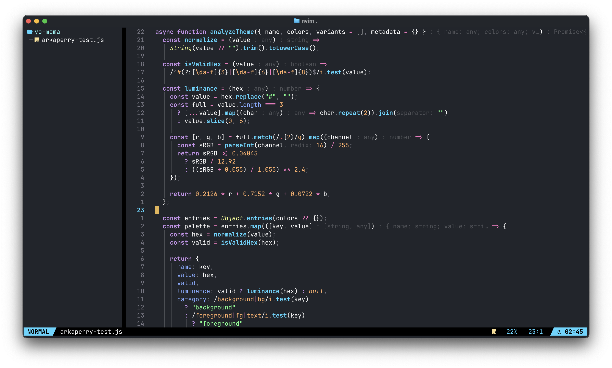

# arkaperry.nvim

**A pure-black Neovim colorscheme with vivid syntax colors and an optional matching statusline.**



## Features

- Pure black background (`#000000`)
- Vivid syntax colors for traditional Vim syntax and Tree-sitter
- Subtle dark window separators
- Optional matching Lualine statusline
- Mode colors: blue **NORMAL**, green **INSERT**, light-purple **VISUAL**

## Installation

### lazy.nvim — colorscheme only

```lua
{
  "thearkabanerjee/arkaperry.nvim",
  priority = 1000,
  config = function()
    vim.cmd.colorscheme("arkaperry")
  end,
}
```

### lazy.nvim — colorscheme and ArkaPerry statusline

The statusline requires [nvim-lualine/lualine.nvim](https://github.com/nvim-lualine/lualine.nvim).

```lua
{
  "thearkabanerjee/arkaperry.nvim",
  dependencies = {
    "nvim-lualine/lualine.nvim",
  },
  priority = 1000,
  config = function()
    vim.cmd.colorscheme("arkaperry")
    require("arkaperry").setup({
      statusline = true,
    })
  end,
}
```

**LazyVim note:** LazyVim may configure Lualine itself. If its own Lualine plugin spec also calls `lualine.setup`, that setup can override this statusline. For the most reliable LazyVim setup, install the colorscheme with the first spec, then configure Lualine in `lua/plugins/arkaperry.lua` using LazyVim's `opts` merge pattern, or disable/remove the competing Lualine configuration. Do not keep two competing Lualine specs that replace each other's sections.

## Manual installation

Copy `colors/arkaperry.lua` to:

```text
~/.config/nvim/colors/arkaperry.lua
```

Then run:

```vim
:colorscheme arkaperry
```

For the optional statusline, copy `lua/arkaperry/` into `~/.config/nvim/lua/arkaperry/`, install Lualine, and use:

```lua
require("arkaperry").setup({ statusline = true })
```

## Palette

| Color | Hex | Use |
| --- | --- | --- |
| Cyan | `#45D6FF` | Functions, Normal mode |
| Green | `#6EFF8A` | Strings, Insert mode |
| Light purple | `#C792EA` | Keywords, Visual mode |
| Orange | `#FFAD66` | Numbers, command mode |
| Pink | `#FF79C6` | Operators and tags |
| Yellow | `#F1FA8C` | Types and constants |
| Blue | `#82AAFF` | Properties and fields |
| Red | `#FF5C70` | Errors and built-ins |
| Background | `#000000` | Main editor background |

## License

MIT License.
